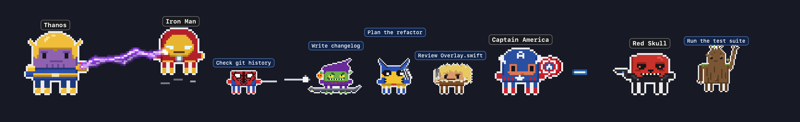
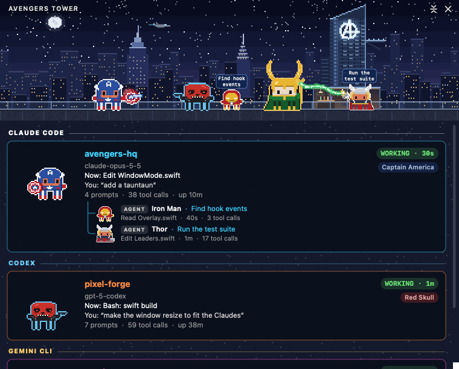

<p align="center">
  
</p>

<h1 align="center">Clawvengers: Clawd Wars</h1>

<p align="center">
  <b>Your Claude Code, Codex, Qwen Code, Gemini CLI and GitHub Copilot CLI sessions, as a pixel-art Clawvel battle on your desktop.</b><br>
  Every session is a hero or a villain, every subagent joins in, and they fight while they work.
</p>

<p align="center">
  <a href="LICENSE"></a>
  
  
  
  <a href="https://github.com/rodclemen/clawd-clash"></a>
</p>

https://github.com/user-attachments/assets/ed78aa3c-79ec-4827-a56b-b6590f905686

<p align="center"><sub>🔊 <b>Click the speaker in the player for sound</b>: GitHub starts videos muted. Full 1080p version: <a href="promo/avengers-clawd-wars-promo.mp4">promo/avengers-clawd-wars-promo.mp4</a></sub></p>

<p align="center">
  
</p>

> **Clawvengers: Clawd Wars is now part of [Clawd Clash](https://github.com/rodclemen/clawd-clash)**, one app with three universes: **Clawvel**, **Star Claws** and **Detective Claws**. This page shows off the Clawvel one. Everything else (all three universes, setup, uninstalling, the source code) lives in the [Clawd Clash repo](https://github.com/rodclemen/clawd-clash).

---

## Contents

- [What it is](#what-it-is)
- [Claude vs Codex vs everyone](#claude-vs-codex-vs-everyone)
- [The cast](#the-cast)
- [How they fight](#how-they-fight)
- [Window mode and the screen saver](#window-mode-and-the-screen-saver)
- [Get it](#get-it)
- [What's new](#whats-new)

## What it is

You run Claude Code in three terminals. One is thinking, one is waiting for your permission, one finished ten minutes ago and you didn't notice. You alt-tab around to find out.

**Clawvengers: Clawd Wars tells you at a glance, without switching windows.**

- 🛡️ **Working?** Your Claude fights: Captain Ameriklaw swings his shield, Iron Clawd fires repulsors, Doctor Stranger casts.
- 💭 **Thinking?** A thought bubble.
- ❗ **Needs you?** A red `!`, and if you ignore it for a minute, it starts jumping up and down. It keeps asking until you answer, however long that takes; press Esc instead and it stands down.
- 😴 **Done and idle?** It stops fighting and passes the time with habits of its own: it glances over its shoulder, shifts its weight, swings its hammer round, checks its gun, lets magic crackle in its hand. And nearly everyone has a move all their own: Iron Clawd flips his faceplate up, Clawverine pops his claws (SNIKT!), Thanoz snaps, Lokee turns into a snake, Star-Laird dances to his tape player, Nightclawler PHOOMFs away and back, Deadpond eats a chimichanga, the Grandmeister dances and laughs. After a couple of minutes it sits down; after five it's asleep (zZz).
- 🦸 **Spawned subagents?** They walk (or fly, or swing) in one by one, each labelled with *what it's doing*, and they leave when they finish.
- 🔍 **Hover** any character for the details: status, how long, the tool it's running right now, your last prompt.
- 🖱️ **Click** any of them to jump straight to that session's terminal or editor tab.

## Claude vs Codex vs everyone

**Claude Code plays the heroes.** Run it alongside **OpenAI Codex**, **Qwen Code**, **Gemini CLI** or **GitHub Copilot CLI** and Claude's sessions and agents are Clawvengers, X-Claws and friends, while the other AI's are Thanoz, Doctor Gloom, Magnetto and the rest. With only Claude running, anyone can turn up, so heroes and villains mix.

You can tell the AIs apart at a glance: Claude's characters keep the white outline; Codex gets cyan, Qwen Code lavender, Gemini CLI gold and Copilot CLI mint. Claude Code sessions in the **Claude desktop app** have a coral outline.

## The cast

**193 characters and 43 places**, every character Clawd (Claude Code's little pixel mascot) in costume, all of it drawn in code: the Clawvengers, the X-Claws, the Guardians of the Clawlaxy, the Fanclawstic Four and the street-level heroes against Thanoz, Lokee, Ultraton, Doctor Gloom, Magnetto, Spider-Clawd's rogues, Hydrax and more. Nearly every character has a signature move it does when idle.

<p align="center">
  
</p>

<details>
<summary><b>105 heroes</b></summary>

Iron Clawd, Captain Ameriklaw, Thorr, The Bulk, Black Window, Hawk-I, Spider-Clawd, Black Panthah, Doctor Stranger, Scarlet Glitch, Vizion, Captain Clawvel, Aunt-Man, The Waspette, Falconer, Winter Trooper, Star-Laird, Gamura, Drex the Destroyer, Racket, Grout, Mantys, Nick Furie, She-Bulk, Clawverine, Cyclopz, Stormy, Jeanne Grae, Professor Why, The Beest, Nightclawler, Gamblit, Rouge, Ice Dude, Colossos, Human Blowtorch, The Thingamajig, Mr. Fanclawstic, Invisibelle, Silver Server, Daredemon, Deadpond, Shang-Chee, Ms. Clawvel, Moon Night, Ghost Biker, War Machina, Wikkan, Speedy, Quicksliver, Kat Bishopp, Yelena Belovna, Okoya, Shuree, Valkyria, Kork, Wonk, Herakles, Sentree, Kosmo the Space Dog, Kraglen, Adam Warlocke, Novah, Kitty Pride, Jubilette, Psyloque, Bisshop, Kable, Havoc, Emma Frosty, Bansheen, Angell, Dominoe, Y-23, Myles Moralez, Spider-Gwyn, Spider-Lady, Black Kat, Luke Kage, Iron Fyst, Jessie Jonez, The Punnisher, Elecktra, Blayde, Black Nite, Monika Rambeaux, Kleah, Doctor Hoodoo, Harold the Duck, Squirrel Gal, Geoff the Land Shark, Frogg of Thunder, Lockjaws, Furbush Man, Moebius, Sylvi, Kid Lokee, Alligator Lokee, Hunter C-16, Red Guardsman, Ka-Zarr, Rescuer, Zabo, Morrie and Dumb-E. Geoff the Land Shark, Zabo, Morrie and Dumb-E only ever show up as agents.

</details>

<details>
<summary><b>88 villains</b></summary>

Thanoz, Lokee, Ultraton, Red Skulk, Doctor Gloom, Hel, Ronnan the Accuser, Nebulah, Ebony Jaw, Chitari, Grandmeister, Ultraton Sentry, Green Gobbler, Venum, Carnaige, Doctor Octoclaw, Mysterioso, Elektro, Vultcher, Rhyno, Sandmann, The Lizzard, Craven, Magnetto, Juggernaught, Sabreclaw, Mistique, Apoclawlypse, Sentinal, Abominator, Fin Fang Fume, MOODOK, Dormamoo, Gloombot, Kingping, Bullseyes, Palm Ninja, Hydrax Agent, M.A.I.M. Agent, Skrall, Taskminder, Baron Zeemo, Whipcrack, Mandarine, Kilmongre, Batrok, Galacticus, Kangg the Conqueror, Mefisto, Knul, Annihilux, High Evolutionist, Morgana, The Scorpyon, Shockr, Hobgobbler, Morbidus, Mister Negatory, Kameleon, Gravestone, Mister Sinistre, Omega Read, Toadie, Pyroh, The Blobb, The Brude, Cassandra Supernova, Gravitron, Absorbent Man, Crimson Dynamite, Wreckker, Baron Bordeaux, Enchantrix, Arnim Zolla, Count Nefarius, The Leeder, Maestroh, Malekeith, Surt, Kursed, Frost Jötunn, Hydrax Super Soldier, Kreek Soldier, Miss Seconds, Kallisto, Exodos, Soul Muncher and Red Room Window. The Ultraton Sentry and the Gloombot only ever show up as agents.

</details>

## How they fight

| Style | Who | What happens |
|---|---|---|
| melee vs melee | shields, hammers, claws, fists, swords | they close in and duel; blows clash with sparks (the giants stand back a bit) |
| ranged vs melee | repulsors, webs, arrows, bullets vs Captain Ameriklaw, Thorr, Clawverine… | the shots come in, the shield or hammer knocks each one away |
| magic vs melee | Doctor Stranger, Scarlet Glitch, Lokee, Thanoz vs a blade or shield | the weapon holds the stream back |
| magic vs ranged | | the gunner gets zapped |
| ranged vs ranged | | a proper shoot-out: they duck, shots collide mid-air, shields flash, shots ping off armour |
| odd one out | | cheers the others on, with sparkles |

Every shooter has its own shots: Iron Clawd's and Captain Clawvel's blasts, Cyclopz's and the Sentinals' beams, Spider-Clawd's webs, Hawk-I's arrows, the Human Blowtorch's and Fin Fang Fume's fire, Ice Dude's ice, Gamblit's charged cards, Bullseyes' knives, the Green Gobbler's pumpkin bombs. Magic streams come in each caster's colours: Doctor Stranger orange, Scarlet Glitch red, Lokee green, Thanoz purple, while Stormy, Elektro and Wikkan throw forked lightning.

**Arch-enemies find each other first**: whenever both are fighting, Captain Ameriklaw takes on Red Skulk, Thorr takes Lokee or Hel, Spider-Clawd the Green Gobbler or Venum, Clawverine Sabreclaw, Black Panthah Kilmongre, Doctor Stranger Dormamoo, The Bulk the Abominator, Daredemon the Kingping or Bullseyes, the Silver Server Galacticus, Aunt-Man Kangg the Conqueror, and more, wherever they are in the line.

**They move like themselves**: Iron Clawd, Thorr, Captain Clawvel, Vizion, Stormy, the Silver Server and the other flyers take off when they cross the stage and land where they're going, and every so often take to the air where they stand; in a fight, the shooters and casters among them go up and keep firing from there. Doctor Stranger, Magnetto, MOODOK and Dormamoo hover; Spider-Clawd swings on a web line.

**Ships pick people up**: when Captain Ameriklaw, Black Window, Hawk-I, Nick Furie, The Bulk, Kat Bishopp or Yelena Belovna finish, the **Clawjet** lands for them; the Guardians of the Clawlaxy get the **Milano**.

## Window mode and the screen saver

It opens in a window by default (switch to the desktop from the menu): the whole crew in a scene, with a card for every session: its project, what it's doing right now, your last prompt, its last reply, and its agents in a little tree. When no AI is running, the window steps aside, and it comes back when one starts.

<p align="center">
  
</p>

The scene is set **where the first session's character belongs**: Clawvengers Tower for Iron Clawd, the Sanctum Sanctorum for Doctor Stranger, Wakandu for Black Panthah, Titan for Thanoz. 43 places, each with something moving: windows lighting up and the Clawjet crossing the skyline behind Clawvengers Tower, the rainbow bridge shimmering at Asgaard, the Sakkar crowd cheering, Nowhere's neon flickering, rain over Hell's Kitchen, Gloomveria in a lightning storm, the Chitari pouring out of the portal at the Battle of New York, Dormamoo's face looming in the Darker Dimension, pterodactyls over the Savage Lands, Galacticus devouring a planet past the Worldship's viewport, the Time Variation Agency's clock ticking, Miss Seconds and all, a hologram turning in Tony Stork's Workshop, cabs and pigeons in New York City, lanterns over Ta Loh.

<p align="center">
  
</p>

**Changing place is a comic-book moment.** Each move somewhere new gets a different comic-book transition: halftone dots printing in the new place, three panels slamming down, a speed-line zoom through a white flash, or an iris closing on a "MEANWHILE, IN WAKANDU…" caption box. The sound effect belongs to someone on screen: SNIKT! (Clawverine, Y-23) rips the old place open with three claw slashes, PHOOMF! (Nightclawler) is a puff of purple smoke, KRA-KA-BOOM! or THOOM! (Thorr) a storm-blue flash forking with lightning, FWIP! (any Spider-Clawd) a red web spinning out, BAROOM! (The Bulk, The Thingamajig) a green and orange blast throwing rubble, and with none of them about, the classic yellow and red KAPOW! starburst. With Deadpond on screen he often takes over: he climbs into the corner and peels the old place off the screen like a comic page, or surfs across on a giant chimichanga yelling CHIMICHANGAAAAA!, with captions of his own ("MEANWHILE, ON A SMALLER BUDGET…").

**The screen saver** (Settings… → Screen Saver → Install…) shows the place full screen with the crew fighting across its floor, a card per session, name tags over every head, a clock and a crawl of what happened lately. Every 10 minutes it moves somewhere new, with one of those transitions. With nothing running, it puts on a show of its own: a random crew of heroes against villains, a local or two among them.

**The little things**: double-click the menu bar shield to hide or show the crew; drag it anywhere on either monitor; keep the window (or the desktop crew) on top of everything, or let it sit behind your windows; **Settings…** (⌘,) has every option in one window; and hold **⌘** in the menu for the **Playground**, where you put anyone on stage and watch them fight.

## Get it

Clawvengers: Clawd Wars is now the Clawvel universe of **[Clawd Clash](https://github.com/rodclemen/clawd-clash)**. It needs macOS 13+ (Apple Silicon or Intel) and at least one of Claude Code, Codex, Qwen Code, Gemini CLI or GitHub Copilot CLI.

```sh
brew install --cask rodclemen/tap/avengers-clawd-wars
```

That installs Clawd Clash, starting in Clawvel. `brew install --cask rodclemen/tap/clawd-clash` installs the same app, or download the zip from [Clawd Clash's releases](https://github.com/rodclemen/clawd-clash/releases), unzip it and drag **Clawd Clash** to Applications.

Already have the old Clawvengers app? Clawd Clash takes over the AIs it had connected and starts in Clawvel, so the old app can go.

**Two more universes come with it**, one setting away (Settings… → Universe, or **Random** to switch on its own every so often):

- **Star Claws**: laser swords, blasters and dark lightning, from the Mos Easy Cantina to the Battle of Froth. Its own page: [Clawd Wars](https://github.com/rodclemen/clawd-wars).
- **Detective Claws**: fists, swords, heat vision, power rings, clawarangs and magic, from the Lookout to the Hall of Gloom. Its own page: [Clawstice League: Clawd Wars](https://github.com/rodclemen/clawstice-league-clawd-wars).

Setup details, uninstalling and the source code are all in the [Clawd Clash README](https://github.com/rodclemen/clawd-clash#readme).

## What's new

[CHANGELOG.md](CHANGELOG.md) lists what changed in the Clawvel universe, in plain words.

## License

**Free to use.** [MIT licensed](LICENSE).

---

<p align="center"><sub>An independent parody fan project, not affiliated with or endorsed by Marvel or Disney. Claude and Clawd belong to Anthropic.</sub></p>
