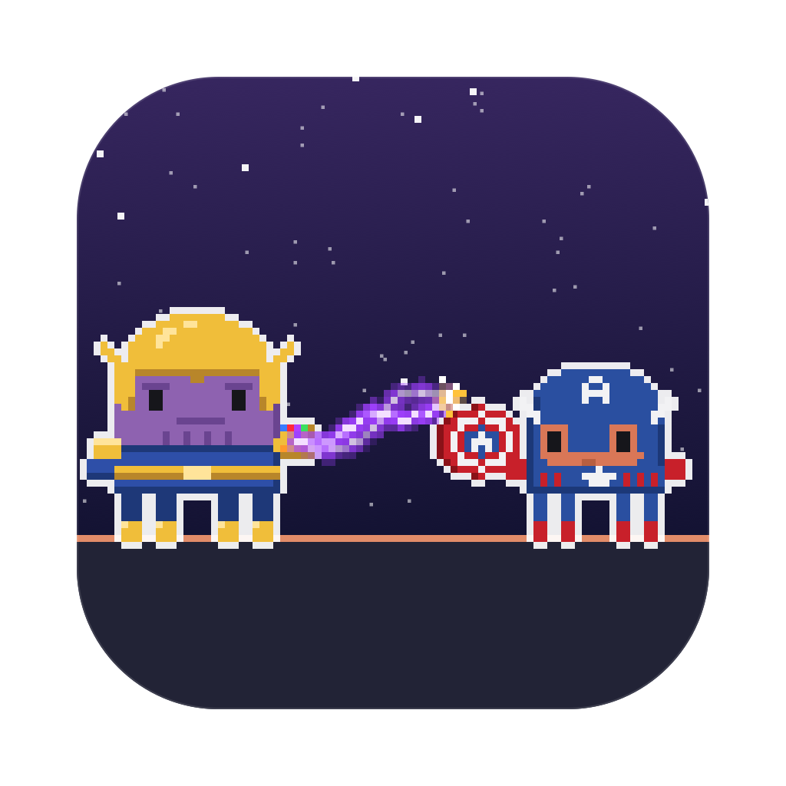
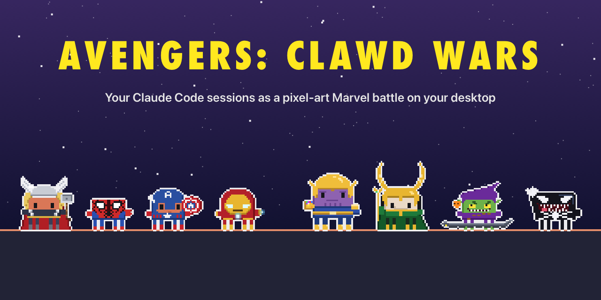
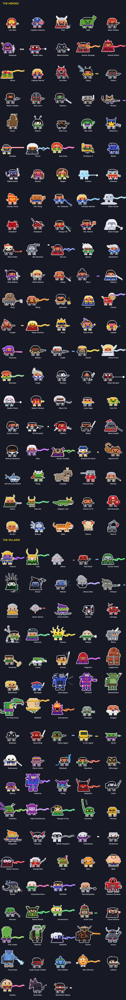
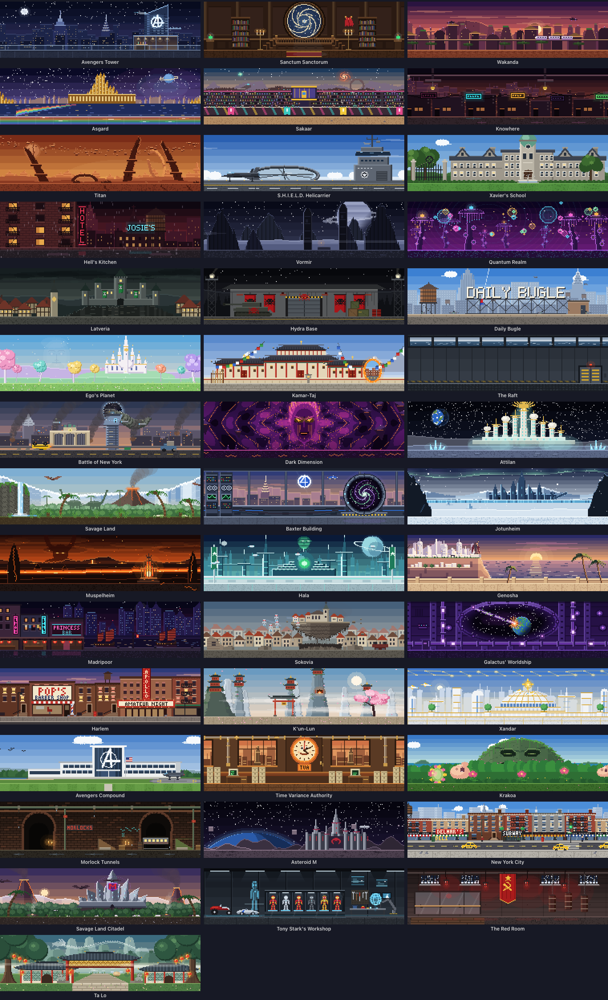

<p align="center">
  
</p>

<h1 align="center">Avengers: Clawd Wars</h1>

<p align="center">
  <b>Your Claude Code, Codex, Qwen Code, Gemini CLI and GitHub Copilot CLI sessions, as a pixel-art Marvel battle on your desktop.</b><br>
  Every session is a hero or a villain, every subagent joins in, and they fight while they work.
</p>

<p align="center">
  <a href="LICENSE"></a>
  
  
  
  
</p>

<p align="center">
  
</p>

The sister app of [Clawd Wars](https://github.com/rodclemen/clawd-wars), the Star Wars one: same engine, same habits, a different universe.

---

## Contents

- [Why you want this](#why-you-want-this)
- [Claude vs Codex vs everyone](#claude-vs-codex-vs-everyone)
- [The roster](#the-roster)
- [How they fight](#how-they-fight)
- [Window mode and the screen saver](#window-mode-and-the-screen-saver)
- [The little things](#the-little-things)
- [Install](#install)
- [How it works](#how-it-works)
- [Uninstall](#uninstall)
- [Contributing](#contributing)
- [License](#license)

## Why you want this

You run Claude Code in three terminals. One is thinking, one is waiting for your permission, one finished ten minutes ago and you didn't notice. You alt-tab around to find out.

**Avengers: Clawd Wars tells you at a glance, without switching windows.**

- 🛡️ **Working?** Your Claude fights: Cap swings his shield, Iron Man fires repulsors, Doctor Strange casts.
- 💭 **Thinking?** A thought bubble.
- ❗ **Needs you?** A red `!`, and if you ignore it for a minute, it starts jumping up and down. It keeps asking until you answer, however long that takes; press Esc instead and it stands down.
- 😴 **Done and idle?** It stops fighting and stands about with habits of its own every 10–20 seconds: it glances over its shoulder, shifts its weight, swings its hammer round, checks its gun, lets magic crackle in its hand. And nearly everyone has a move all their own: Iron Man flips his faceplate up, Wolverine pops his claws (SNIKT), Thanos snaps, Loki turns into a snake, Star-Lord dances with his Walkman, Nightcrawler BAMFs away and back, Deadpool eats a chimichanga, the Grandmaster dances and laughs. After a couple of minutes it sits down; after five it's asleep (zZz).
- 🦸 **Spawned subagents?** They walk (or fly, or swing) in one by one, each labelled with *what it's doing*, and they leave when they finish. Flyers take off; Cap, Black Widow, Hawkeye, Nick Fury and the Hulk get picked up by the Quinjet, and the Guardians by the Milano.
- 🔍 **Want details?** Hover any character: status, how long, the tool it's running right now, your last prompt.
- 🖱️ **Click any of them** to jump straight to that session's terminal or VS Code tab.

It sits on the bottom of your screen, above every window, and it's click-through everywhere except the characters. No dashboard to open, no tab to check.

## Claude vs Codex vs everyone

**Claude Code plays the heroes.** Run it alongside **OpenAI Codex**, **Qwen Code**, **Gemini CLI** or **GitHub Copilot CLI** and Claude's sessions and agents are Avengers, X-Men and friends, while the other AI's are Thanos, Doom, Magneto and the rest. With only Claude running, anyone can turn up, so heroes and villains mix.

You can tell the AIs apart at a glance: Claude's characters keep the white outline; Codex gets cyan, Qwen Code lavender, Gemini CLI gold and Copilot CLI mint. Claude Code sessions in the **Claude desktop app** have a coral outline.

## The roster

Every character is Clawd (Claude Code's little pixel mascot) in costume, drawn in code: no sprite sheets, no image assets (even the app icon is rendered by the same code). Mostly classic comic looks, the film version where it reads better.

<p align="center">
  
</p>

**46 heroes**: Iron Man, Captain America, Thor, Hulk, Black Widow, Hawkeye, Spider-Man, Black Panther, Doctor Strange, Scarlet Witch, Vision, Captain Marvel, Ant-Man, Wasp, Falcon, Winter Soldier, Star-Lord, Gamora, Drax, Rocket, Groot (*"I am Groot."*), Mantis, Nick Fury, She-Hulk, Wolverine, Cyclops, Storm, Jean Grey, Professor X (in his hover-chair), Beast, Nightcrawler, Gambit, Rogue, Iceman, Colossus, the Human Torch (*"Flame on!"*), the Thing (*"It's clobberin' time!"*), Mr. Fantastic, the Invisible Woman, the Silver Surfer, Daredevil, Deadpool (*"Maximum effort!"*), Shang-Chi, Ms. Marvel, Moon Knight and Ghost Rider.

**46 villains**: Thanos (*"I am inevitable."*), Loki, Ultron, Red Skull, Doctor Doom (*"Kneel before Doom!"*), Hela, Ronan, Nebula, Ebony Maw, a Chitauri soldier, the Grandmaster (who laughs at all of it), the Green Goblin on his glider, Venom, Carnage, Doctor Octopus, Mysterio, Electro, the Vulture, the Rhino, Sandman, the Lizard, Kraven, Magneto, the Juggernaut (*"I'm the Juggernaut!"*), Sabretooth, Mystique, Apocalypse, a Sentinel, the Abomination, Fin Fang Foom, MODOK, Dormammu, the Kingpin, Bullseye, a Hand ninja, a Hydra agent (*"Hail Hydra!"*), an A.I.M. beekeeper, a Skrull, Taskmaster, Baron Zemo, Whiplash, the Mandarin, Killmonger and Batroc. An Ultron Sentry and a Doombot only ever show up as agents.

## How they fight

| Style | Who | What happens |
|---|---|---|
| melee vs melee | shields, hammers, claws, fists, swords | they close in and duel; blows clash with sparks (the giants stand back a bit) |
| ranged vs melee | repulsors, webs, arrows, bullets vs Cap, Thor, Wolverine… | the shots come in, the shield or hammer knocks each one away |
| magic vs melee | Strange, Wanda, Loki, Thanos' gauntlet vs a blade or shield | the weapon holds the stream back |
| magic vs ranged | | the gunner gets zapped |
| ranged vs ranged | | a proper shoot-out: they duck, shots collide mid-air, shields flash, shots ping off armour |
| odd one out | | cheers the others on, with sparkles |

Every shooter has its own shots: Iron Man's and Captain Marvel's blasts, Cyclops' and the Sentinels' beams, Spider-Man's webs, Hawkeye's arrows, the Torch's and Fin Fang Foom's fire, Iceman's ice, Gambit's charged cards, Bullseye's knives, the Goblin's pumpkin bombs. Magic streams come in each caster's colours: Strange orange, Wanda red, Loki green, Thanos purple, Storm and Electro as forked lightning.

**Arch-enemies find each other first**: whenever both are fighting, Captain America takes on Red Skull, Thor takes Loki or Hela, Spider-Man the Green Goblin or Venom, Wolverine Sabretooth, Black Panther Killmonger, Doctor Strange Dormammu, the Hulk the Abomination, Daredevil the Kingpin or Bullseye, and more, wherever they are in the line.

**They move like themselves**: Iron Man, Thor, Captain Marvel, Vision, Storm, the Surfer and the other flyers take off when they cross the stage and land where they're going (and fly away when they're done); Doctor Strange, Magneto, MODOK and Dormammu hover; Spider-Man swings on a web line.

## Window mode and the screen saver

It opens in a window by default (switch to the desktop from the menu): the whole crew in a scene, with a card for every session: its project, what it's doing right now, your last prompt, its last reply, and its agents in a little tree.

The scene is set **where the first session's character belongs**: Avengers Tower for Iron Man, the Sanctum for Doctor Strange, Wakanda for Black Panther, Titan for Thanos. 22 places, each with something moving: windows lighting up and a Quinjet crossing the Manhattan skyline, the Seal of the Vishanti in the Sanctum's window, Talon fighters over the Golden City, the Bifrost shimmering, the Sakaar crowd cheering, Knowhere's neon flickering, rain over Hell's Kitchen, Castle Doom in a lightning storm, the Chitauri pouring out of the portal over New York, Dormammu's face looming, pterodactyls over the Savage Land:

<p align="center">
  
</p>

**The screen saver** (Settings → Install Screen Saver…) shows the window's place full screen with the crew fighting across its floor, a card per session, name tags over every head, a clock and a crawl of what happened lately. Every 10 minutes it wipes to somewhere new. With nothing running, it puts on a show of its own: a random crew of heroes against villains, a local or two among them.

## The little things

| You see | It means |
|---|---|
| fighting | Claude is running tools |
| 💭 thought bubble | thinking |
| red `!` | waiting for your permission, **jumping** after a minute |
| `?` | that session started before the hooks were installed; restart it for live status |
| sitting on the floor | idle for 2+ minutes |
| zZz | idle for 5+ minutes |
| bobbing yellow marker | the Claude whose terminal you're looking at right now |
| matching label colours | a Claude and its agents share their project's colour |

- **Double-click the menu bar shield** to hide or show the crew; a single click opens the menu.
- **Drag** the crew anywhere on either monitor; **hover** for a details card; **click** to jump to the exact terminal tab or editor window.
- **Status Symbols** in the menu is the same key, drawn with the app's own sprites.
- Hold **⌘** in the menu for the **Playground** (put anyone on stage and watch them fight) and Demo Mode.

## Install

Needs macOS 13+ (Apple Silicon or Intel) and at least one of [Claude Code](https://claude.com/claude-code), [Codex](https://developers.openai.com/codex), [Qwen Code](https://github.com/QwenLM/qwen-code), [Gemini CLI](https://github.com/google-gemini/gemini-cli) or [GitHub Copilot CLI](https://github.com/github/copilot-cli). It asks before connecting any of them, and only touches the ones you connect.

**It lives happily next to Clawd Wars.** It has its own name, hook (`avengers-hook`), status file and screen saver, and each app only ever adds or removes its own hook entries.

**From source** (no Xcode project, no packages, only Apple's free Command Line Tools):

```sh
xcode-select --install     # one time, if you don't have the developer tools
git clone https://github.com/rodclemen/avengers-clawd-wars.git && cd avengers-clawd-wars
./build.sh --no-install    # build and run the copy in build/: nothing installed, no AI's settings changed
./build.sh                 # build, install "Avengers Clawd Wars.app" to /Applications, refresh connected hooks, launch
```

Claude Code sessions that were already running pick up the hooks after a restart (`/exit`, then `claude --continue`). Until then they still show up, with a `?`.

> **Codex users:** Codex only runs hooks you've approved. After connecting it, run **`/hooks`** in Codex once and approve Avengers: Clawd Wars.

Clicking to jump to a session in Terminal or iTerm2 asks once for **Automation** permission; jumping to VS Code or Cursor asks once for **Accessibility** permission. Building, signing and toolchain troubleshooting work exactly as in [Clawd Wars' README](https://github.com/rodclemen/clawd-wars#building-from-source-what-you-need).

## How it works

- A tiny Foundation-only binary, `avengers-hook`, is registered for each connected AI's hook events (session start/end, prompts, tool calls, permission requests, subagents, stop). It writes `~/.claude/avengers-status/state.json` under a file lock and exits silently, so it can never get in Claude's way.
- The app reads that twice a second, finds sessions without hooks from the process table, and drops a session the moment its process exits.
- Everything you see (the characters, weapons, effects, locations, ships and the icon) is pixel art drawn in Swift at runtime. The whole app, art included, is a couple of megabytes; only the characters and the place on screen are ever drawn.
- The first install backs up each AI's settings (`…before-avengers-clawd-wars`).

## Uninstall

Menu bar shield → **Settings → Remove … Hooks** for each connected AI, then **Quit**. Or from the terminal:

```sh
"/Applications/Avengers Clawd Wars.app/Contents/MacOS/AvengersClawdWars" --uninstall-hooks
rm -rf "/Applications/Avengers Clawd Wars.app" ~/.claude/avengers-status
```

## Contributing

Characters and places are data plus drawing code, with no assets to wrangle:

- **A character** is a `Persona` (name, weapon, how it moves, what its shots or magic look like, its signature move) registered next to its drawing function in one of the `Sources/App/Art/*.swift` files. Add its case at the **end** of `Companion` (heroes) or `Leader` (villains) in `Sources/App/Roster.swift` (ids are saved, so never reorder), give it a home in `Location.home(of:)`, and bump the count in `Sources/Shared/StatusStore.swift`. `Sources/App/Pose.swift` explains what a drawing function gets and must do.
- **A place** is a `Place` in one of the `Sources/App/Places/*.swift` files: a still picture and an optional moving layer.
- **Check it** with the preview tool: `Tools/Preview/build.sh`, then `build/preview cast out.png thor` (every pose), `build/preview fight out.png thor loki`, `build/preview place out.png asgard`, `build/preview rides out.png`. Regenerate the README sheets with `Tools/RenderDocs` and the icon with `Tools/MakeIcon`.

## License

**Free to use.** The code is [MIT licensed](LICENSE): use it, change it, share it, just keep the license notice.

---

<p align="center"><sub>A fan project. Marvel and its characters belong to Marvel/Disney; Claude and Clawd belong to Anthropic.<br>Not affiliated with or endorsed by either.</sub></p>
